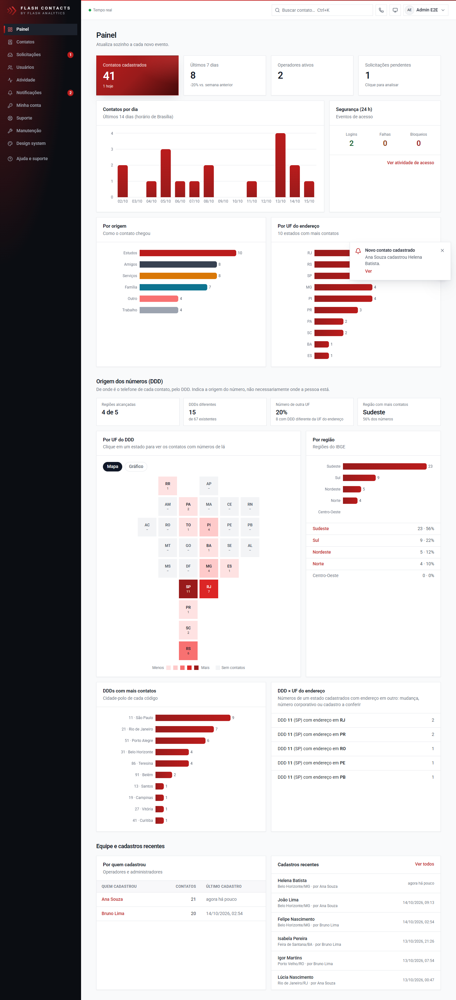
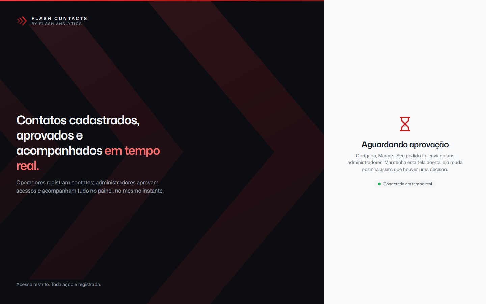

# Flash Contacts

_by Flash Analytics_

Aplicação web para **cadastro de contatos com controle de acesso por perfil**. Operadores pedem acesso pela tela de login e
esperam a aprovação **em tempo real**. Depois de aprovados, cadastram contatos. Administradores aprovam acessos, criam
usuários, recebem **notificação em tempo real** de cada contato novo e acompanham tudo num **painel ao vivo** e numa
**trilha de auditoria**.

**No ar:** https://flash.vittorccf.com.br (Vercel em São Paulo + Neon Postgres em São Paulo). Para avaliar como operador,
use "Solicitar acesso" na tela de login; o pedido aparece em tempo real para o admin aprovar.

> Briefing do teste, requisitos e decisões: [`docs/REQUISITOS.md`](docs/REQUISITOS.md) ·
> Arquitetura e UML: [`docs/ARQUITETURA.md`](docs/ARQUITETURA.md) ·
> Segurança: [`docs/SEGURANCA.md`](docs/SEGURANCA.md) ·
> Prós e contras das escolhas: [`docs/DECISOES.md`](docs/DECISOES.md) ·
> Design system (marca, tokens, componentes): [`docs/DESIGN-SYSTEM.md`](docs/DESIGN-SYSTEM.md)

| Admin: painel em tempo real | Operador: aguardando aprovação |
| --- | --- |
|  |  |

## O que tem

| Requisito do teste | Onde está |
| --- | --- |
| Tela de login, 2+ perfis (admin e operador) | `/login` · sessões no banco, argon2id, bloqueio por tentativas, 2FA opcional |
| Admin cadastra usuários | `/admin/usuarios`: senha provisória exibida uma vez, troca obrigatória no 1º acesso |
| Admin recebe solicitações de cadastro | `/admin/solicitacoes`: lista ao vivo, aprovar/recusar com motivo |
| Admin analisa o que acontece na aplicação | `/admin/atividade`: auditoria ao vivo (logins, falhas, bloqueios, aprovações, contatos) |
| Operador pede acesso na tela de login e **espera a aprovação em tempo real, sem atualizar a tela** | aba "Solicitar acesso" + painel de espera via Server-Sent Events |
| Operador cadastra contatos | `/contatos/novo`, com endereço preenchido pelo CEP (ViaCEP, BrasilAPI de reserva). O admin também cadastra; os outros admins são notificados |
| Extra: CRUD, importar e exportar | Ver, editar e excluir contato (operador só os seus); exportar **Excel/CSV** com os filtros da tela; importar **.xlsx/CSV** com modelo, validação por linha e duplicados pulados; admin edita e exclui usuários |
| Extra: falar com o contato | Ao lado do número: **WhatsApp** (app ou Web; opaco quando o número não deve ter), **ligar** e **SMS** (o sistema pergunta qual app usar). Ao lado do e-mail: app padrão, Gmail ou Outlook |
| Extra: equipe e organização | **Permissões** por usuário (Leitor, Editor, Criar, Apagar, Exportar); **foto de perfil**; **tema escuro**; **busca** no topo (Ctrl+K) e **discador**; **favoritos**, **ordenação** por coluna, **aviso de duplicado**; **notas** e **histórico** (quem criou/alterou) no contato; **compartilhar** (link, WhatsApp, e-mail, .vcf) |
| Extra: manutenção | **Job diário de limpeza** (Cron da Vercel ou `npm run job:limpeza`), **dados de teste** e **limpar a base** em `/admin/manutencao` |
| Extra: suporte | Botão flutuante (pode ser escondido) com tipo de problema e mensagem: o chamado fica gravado (`/admin/suporte`), os admins são avisados e a pessoa envia pelo WhatsApp com a mensagem pronta |
| Todo contato gera **notificação em tempo real** para o admin | aviso na tela + contador no menu + histórico em `/notificacoes` |
| Admin e operador têm lista de contatos **paginada no backend** | `/contatos`: 10 por página com **cursor (keyset)** no Postgres, na ordem escolhida; busca e filtros |
| Extra: dashboard com métricas | `/admin`: total, hoje, 7 dias vs. semana anterior, por dia, por origem, por UF, por quem cadastrou, segurança 24 h e **origem dos números pelo DDD** (mapa do Brasil e gráfico por UF, regiões, DDDs mais frequentes, DDD × endereço). **Atualiza em tempo real** |
| Extra: design system da marca | Tokens, Roboto, profundidade (elevação), logo e componentes · catálogo vivo em `/design-system` · contraste WCAG AA testado |
| Extra: deploy | Vercel + Neon (SaaS) **ou** Docker Compose (on-premises), CI no GitHub Actions |

## Suporte

Dúvidas ou problemas: **WhatsApp (64) 99936-8321** · **vittorccf@gmail.com** (também no botão de suporte do sistema).

## Stack

Next.js 16 (App Router, Server Components e Server Actions) · TypeScript · PostgreSQL · Prisma 7 (driver `pg`) · Tailwind 4 · zod ·
argon2id (`@node-rs/argon2`) · tempo real com Postgres `LISTEN/NOTIFY` + Server-Sent Events · Vitest e Playwright.

Por que essa stack, o que ela custa, por que não Supabase e o que eu mudaria num produto (em especial: autenticação
por um provedor de identidade em vez de própria) estão em [`docs/DECISOES.md`](docs/DECISOES.md).

## Como rodar localmente

Pré-requisito: **Node.js 22 ou superior** (testado com 24). Não precisa de Docker: o Postgres de desenvolvimento é
embutido (binários oficiais via npm).

```bash
npm install
cp .env.example .env            # os valores padrão já funcionam localmente

# Terminal 1: Postgres local em localhost:5433 (dados em .pgdata). Aplica as migrations.
npm run db:local

# Terminal 2
npm run db:admin -- --email admin@empresa.com --name "Seu Nome"   # mostra a senha provisória uma única vez
SEED_DEMO=1 npm run db:seed     # opcional: 2 operadores + 25 contatos (mostra as senhas)
npm run dev                     # http://localhost:3000
```

No Windows (PowerShell), o seed fica `$env:SEED_DEMO=1; npm run db:seed`.

Para escolher a senha do admin em vez de gerar uma: `ADMIN_PASSWORD="uma frase longa" npm run db:admin -- --email ...`.

### Roteiro de avaliação (5 minutos)

1. Abra `http://localhost:3000` numa janela e entre como **admin** (vai pedir para trocar a senha provisória).
2. Numa **janela anônima**, clique em **Solicitar acesso** e preencha. A tela fica em "Aguardando aprovação".
3. Na janela do admin aparece o aviso. Em **Solicitações**, aprove. A janela anônima muda para "Acesso aprovado!"
   **sem recarregar**.
4. Entre como operador e cadastre um contato. O admin recebe o aviso na hora e o **Painel** se atualiza sozinho.
5. Em **Usuários**, desative o operador: a sessão aberta dele cai na hora e volta para o login.
6. Em **Atividade**, veja tudo isso registrado, com IP e navegador.

### Build de produção local

```bash
npm run build
COOKIE_SECURE=false npm start   # COOKIE_SECURE=false só porque localhost é http
```

## Testes

```bash
npm run lint && npm run typecheck
npm test            # unitários (Vitest): política de senha, validação, paginação, TOTP (vetor da RFC), cifra, argon2,
                    # contraste WCAG dos tokens e ausência de cor fixa nos componentes
npm run test:e2e    # ponta a ponta (Playwright) contra o build de produção, com Postgres descartável próprio
```

Os 13 testes ponta a ponta cobrem os fluxos do enunciado (aprovação vista em tempo real **sem recarregar**, recusa,
notificação do contato no painel, paginação por cursor de 23 contatos em 3 páginas, ida e volta) e os controles de segurança (cabeçalhos/CSP,
cookie `__Host-` + `HttpOnly` + `SameSite=Strict`, token só como hash no banco, cookie forjado, mensagem que não revela
contas, bloqueio após 5 erros, bloqueio por força bruta no 2FA mesmo sabendo a senha, isolamento operador × admin e operador × operador, sessão derrubada em tempo real ao
desativar, 2FA com proteção contra reuso de código).

Sem acesso para baixar o navegador do Playwright, use um Chromium já instalado:
`PW_CHROMIUM_PATH=/caminho/do/chrome npm run test:e2e`.

## Deploy

### SaaS: Vercel + Neon (recomendado)

1. Crie um banco **Neon** (Postgres) e copie as duas URLs: a *pooled* e a *direct/unpooled*.
2. Importe o repositório na Vercel. O `vercel-build` do `package.json` aplica as migrations e faz o build.
3. Variáveis de ambiente (Production):

   | Variável | Valor |
   | --- | --- |
   | `DATABASE_URL` | URL *pooled* da Neon |
   | `DATABASE_URL_UNPOOLED` | URL *direct* da Neon (migrations e `LISTEN` do tempo real) |
   | `ENCRYPTION_KEY` | `openssl rand -base64 32` |
   | `TRUSTED_IP_HEADER` | `x-forwarded-for` (a Vercel sobrescreve esse cabeçalho) |
   | `CEP_PROVIDER` | `remote` (padrão; pode omitir) |

4. Crie o admin uma vez, da sua máquina, apontando para o banco de produção:
   `DATABASE_URL="<url direct>" npm run db:admin -- --email voce@empresa.com --name "Seu Nome"`.

Os streams de tempo real usam funções Node.js comuns (Fluid Compute). Cada conexão SSE dura até ~5 min e o navegador
reconecta sozinho, já recarregando o que possa ter perdido.

### On-premises: Docker Compose

```bash
ENCRYPTION_KEY=$(openssl rand -base64 32) POSTGRES_PASSWORD=<senha-forte> docker compose up -d --build
docker compose run --rm migrate npx tsx scripts/create-admin.ts --email admin@empresa.com --name "Admin"
```

A imagem é multi-stage, roda sem root e tem health check em `/api/health`. Em produção, ponha um proxy TLS na frente
com `COOKIE_SECURE=true` e `TRUSTED_IP_HEADER=x-forwarded-for`. A busca de CEP precisa de saída para
`viacep.com.br` e `brasilapi.com.br`; sem internet, use `CEP_PROVIDER=off` (o endereço fica manual).

> **Transparência:** o Docker não estava disponível na máquina de desenvolvimento, então o `Dockerfile` e o
> `docker-compose.yml` **não foram executados**. Validei a parte mais sensível, o build `standalone` levando o binário
> nativo do argon2 e o runtime do Prisma 7, mas a imagem em si precisa de um primeiro teste.

## Estrutura

```
src/
  proxy.ts                 CSP com nonce, cabeçalhos de segurança, redirecionamento otimista
  app/                     telas (Server Components) e Server Actions de cada tela
    login/                 login, solicitação de acesso, tela de espera, 2FA
    (app)/                 área logada: contatos, admin (painel, solicitações, usuários, atividade), conta
    api/                   SSE (/events, /signup-requests/stream), /session, /health
  server/                  regras de negócio e acesso a dados (nunca importado pelo navegador)
    auth/                  sessão, DAL (requireAdmin/requireOperator), login, senha, TOTP, rate limit
    realtime/              eventos de domínio, barramento LISTEN/NOTIFY, resposta SSE
    contacts.ts, signup-requests.ts, users.ts, notifications.ts, dashboard.ts, activity.ts, audit.ts
  lib/                     regras puras compartilhadas: validação (zod), política de senha, telefone, paginação
  components/              design system (ui.tsx, brand.tsx) e cliente de tempo real
prisma/                    schema, migrations, seed de demonstração
tests/unit, tests/e2e      Vitest e Playwright
docs/                      requisitos, arquitetura/UML, segurança, decisões, design system, capturas de tela
```
