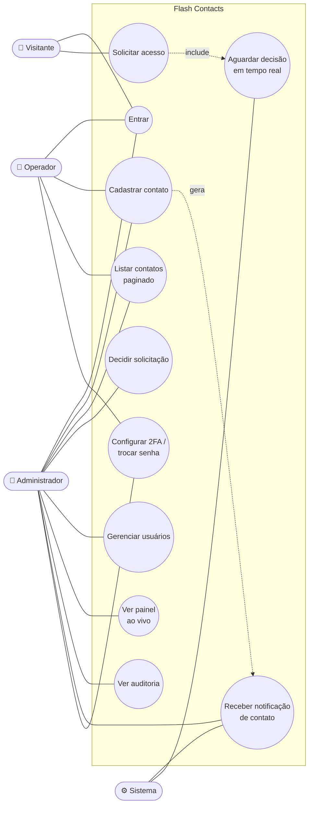
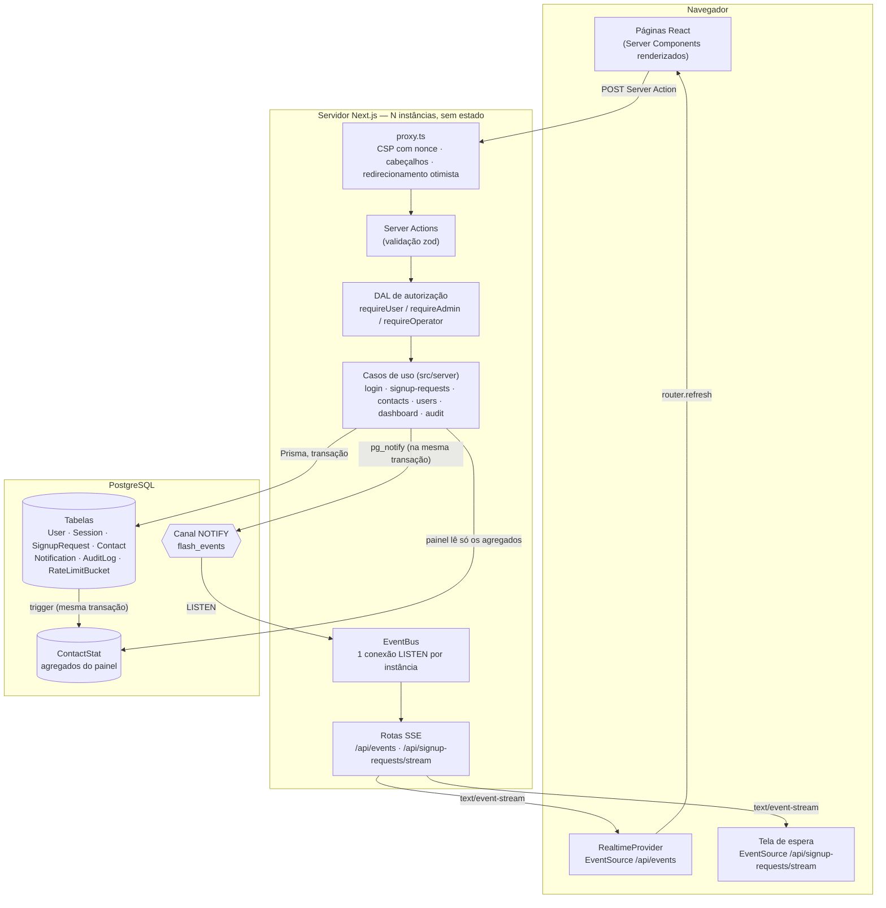
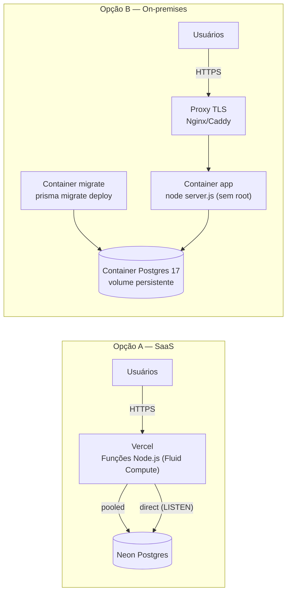
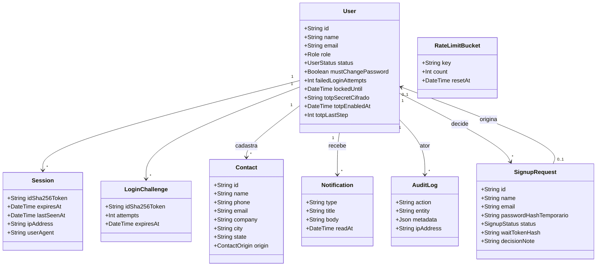
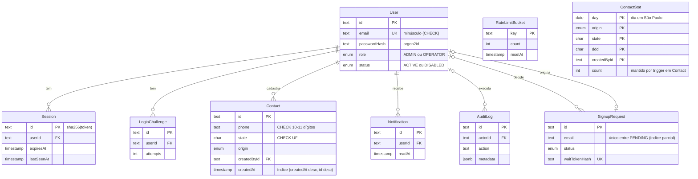
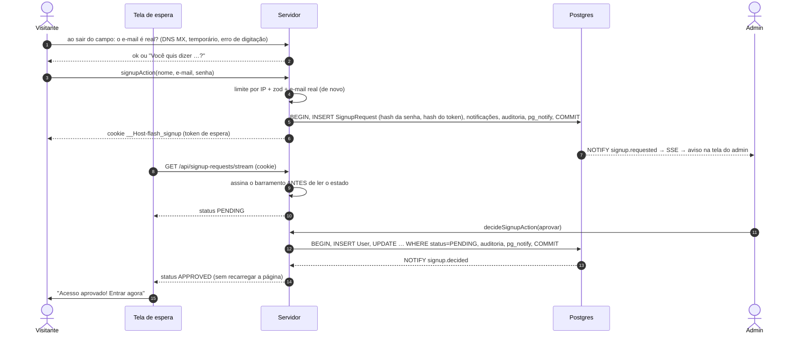
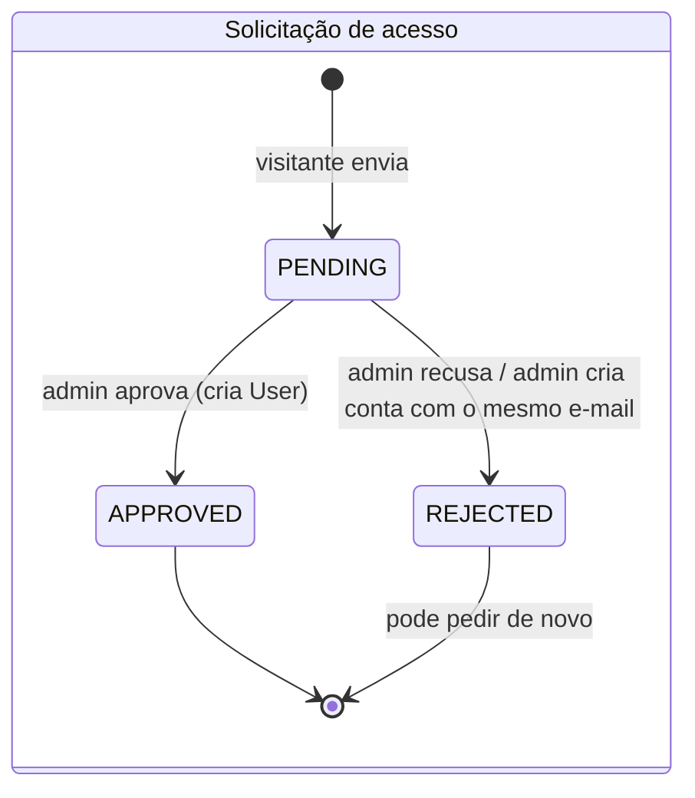
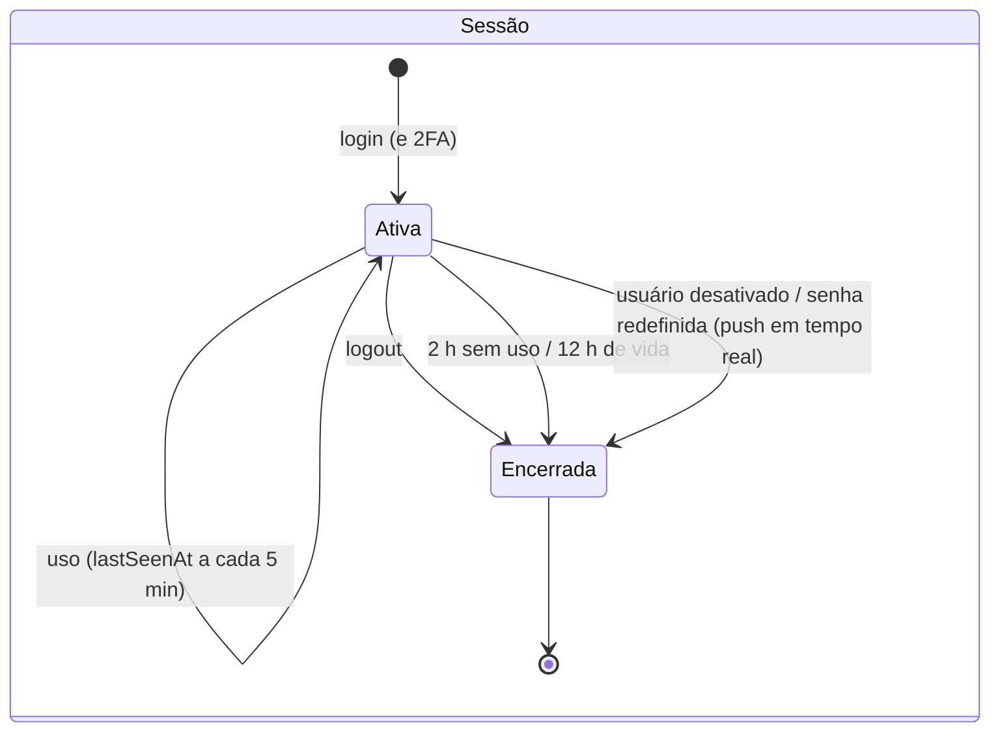

# Arquitetura e UML

Os diagramas estão em Mermaid, que o GitHub renderiza direto. Cada um responde a uma pergunta: quem usa
(casos de uso), do que o sistema é feito (componentes e implantação), quais são os dados (classes e ER) e como os
fluxos críticos acontecem (sequências e estados).

## 1. Casos de uso



## 2. Componentes



**Camadas:** a tela só chama a Server Action, que valida a entrada (zod) e passa pela DAL. O caso de uso em `src/server`
aplica as regras de negócio e é o único que fala com o Prisma. Regras de visibilidade (ex.: operador só vê os próprios
contatos) ficam no caso de uso, não na tela, para nenhuma tela esquecer de aplicá-las.

## 3. Implantação



## 4. Modelo de domínio (classes)



## 5. Modelo de dados (ER)



## 6. Sequência: login (com bloqueio e 2FA)

```mermaid
sequenceDiagram
  autonumber
  actor U as Usuário
  participant B as Navegador
  participant SA as loginAction
  participant L as authenticate()
  participant DB as Postgres

  U->>B: e-mail + senha
  B->>SA: POST (Server Action, checagem de Origin)
  SA->>SA: zod (normaliza e-mail)
  SA->>L: authenticate(email, senha, ip)
  L->>DB: consume rate limit por IP + consulta falhas por e-mail
  alt limite excedido
    L-->>B: "Muitas tentativas…" (auditado)
  end
  L->>DB: busca usuário
  alt e-mail não existe
    L->>L: argon2 em hash fictício (mesmo tempo de resposta)
    L-->>B: mensagem genérica (auditado)
  else conta bloqueada ou 5 tentativas em curso
    L->>L: argon2 em hash fictício (mesmo tempo de resposta)
    L-->>B: mensagem genérica (reserva recusada: UPDATE … WHERE tentativas < 5)
  else senha errada
    L->>DB: tentativa já reservada; bloqueia em 5 (erros de 2FA somam aqui)
    L-->>B: mensagem genérica (auditado)
  else senha certa e 2FA ativo
    L->>DB: cria LoginChallenge (hash do token, 5 min)
    L-->>B: cookie __Host-flash_2fa → /login/verificar
    U->>B: código TOTP
    B->>DB: valida código e reserva o passo (não reutilizável)
  end
  L->>DB: cria Session (sha256 do token)
  L-->>B: Set-Cookie __Host-flash_session (HttpOnly, Secure, SameSite=Strict)
```

## 7. Sequência: solicitação de acesso e aprovação em tempo real



## 8. Sequência: contato cadastrado → notificação do admin

```mermaid
sequenceDiagram
  autonumber
  actor O as Operador
  participant S as Servidor (instância 1)
  participant DB as Postgres
  participant S2 as Servidor (instância 2)
  actor A as Admin

  Note over A,S2: o admin está conectado em /api/events numa outra instância
  O->>S: createContactAction(form)
  S->>S: requirePermission("contacts.create") + zod
  S->>DB: BEGIN, INSERT Contact, INSERT Notification (1 por admin), INSERT AuditLog, pg_notify(contact.created), COMMIT
  DB-->>S2: NOTIFY (só depois do COMMIT)
  S2->>S2: filtra por perfil (admin recebe; outro operador não)
  S2-->>A: event contact.created
  A->>A: aviso na tela + router.refresh()
  A->>S2: RSC refresh (painel, contadores)
```

## 9. Estados





## 10. Tempo real em detalhe

- **Publicação transacional:** `pg_notify` roda dentro da mesma transação que grava o dado. Se a transação falha,
  nenhum evento sai. Também não há aviso de contato que depois "não existe".
- **Assinatura:** cada instância do servidor mantém **uma** conexão `LISTEN` (conexão direta, sem pooler) e distribui
  os eventos para os streams SSE abertos nela. Com N instâncias, cada uma escuta o Postgres, então não é preciso
  "sticky session" nem Redis.
- **Payload mínimo:** o evento leva só ids e nomes para o aviso. A tela recarrega os dados pelo caminho normal
  (`router.refresh()` → Server Components → DAL), então as regras de acesso valem também para o que chega em tempo real.
- **Filtro por perfil:** `/api/events` só repassa a cada usuário o que o perfil dele pode ver. O stream da tela de
  espera só fala da própria solicitação.
- **Falhas:** heartbeat a cada 20 s; o stream fecha antes do limite de duração da plataforma e o navegador reconecta.
  Numa reconexão (do navegador ou do `LISTEN`), quem assina recebe `resync` e recarrega, cobrindo eventos perdidos
  enquanto estava fora. Resposta de erro (ex.: deploy) → o cliente checa `/api/session`: sessão inválida volta ao
  login, válida reabre com espera crescente.
- **Revogação:** desativar um usuário publica `session.revoked`; o stream dele envia o evento e fecha, e o navegador
  vai para o login. Além disso, cada stream revalida a sessão a cada 60 s.

## 11. Escalabilidade: o que muda com o volume

| Gargalo | Quando aparece | Próximo passo |
| --- | --- | --- |
| ~~`OFFSET` em páginas profundas~~ | resolvido | contatos e atividade paginam por cursor (keyset) na ordem escolhida, `src/lib/cursor.ts` |
| ~~`COUNT(*)` da paginação~~ | resolvido em parte | o total de contatos vem de `ContactStat`; só busca por texto e favoritos contam na tabela. A atividade não mostra total |
| ~~Agregações do painel~~ | resolvido | `ContactStat` (dia/origem/UF/DDD/autor) mantida por trigger na mesma transação; `contact_stat_rebuild()` reconstrói |
| Ordenar por nome/cidade com milhões de linhas | busca + ordenação fora do índice | índices `(name, id)`/`(city, id)` ou busca dedicada (pg_trgm / motor de busca) |
| Conexões SSE | milhares de usuários simultâneos | serviço gerenciado (Ably/Pusher) ou WebSocket dedicado; a interface `subscribe()` do cliente fica igual |
| `NOTIFY` | milhares de eventos/s | Redis Pub/Sub ou fila; troca só `src/server/realtime/bus.ts` e `publish()` |
| Auditoria no banco principal | retenção longa | exportar para armazenamento imutável (S3 Object Lock) ou SIEM |
