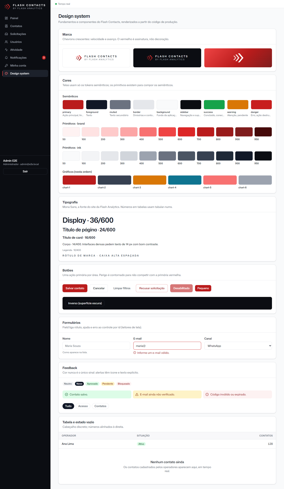

# Design system: Flash Contacts

Flash Contacts é um produto da **Flash Analytics**. O design system parte da marca existente (logo de chevrons e site
[flashanalytics.com.br](https://flashanalytics.com.br/)) e serve a um uso específico: telas densas de operação, com
formulários, tabelas e painel. Quem usa passa o dia nelas.

- **Fonte de verdade:** `src/app/globals.css` (tokens) e `src/components/ui.tsx` + `src/components/brand.tsx`
  (componentes). Nada de Figma paralelo para manter sincronizado.
- **Catálogo vivo:** `/design-system` (logado; no menu do admin). Ele renderiza os componentes de produção, então
  não fica desatualizado.
- **Guarda automatizada:** `tests/unit/design-tokens.test.ts` falha se um par de cores cair abaixo do contraste WCAG AA
  ou se algum componente usar cor fixa fora dos tokens.

## Princípios

1. **Vermelho é assinatura, não semáforo.** A marca é vermelha e o erro também. Por isso, o vermelho cheio fica para a
   ação principal e para a identidade. Seleção, foco e destaques informativos usam grafite. Erro sempre vem com ícone e
   texto, e a ação destrutiva é um botão *contornado*.
2. **Dado primeiro.** Superfícies claras e neutras, uma ação primária por área e números com `tabular-nums`. A marca
   aparece na moldura (sidebar, login), não no meio dos dados.
3. **Acessível por padrão.** Contraste AA testado, foco sempre visível (inclusive em superfícies escuras),
   `prefers-reduced-motion` respeitado e campos ligados a rótulo, ajuda e erro por `id`.
4. **Uma fonte de verdade, sem exceções locais.** Tela usa token semântico. Precisa de algo novo? Crie o token ou o
   componente aqui, nunca uma cor solta na tela.

## Marca

| Elemento | Regra |
| --- | --- |
| Símbolo | Três chevrons crescentes (velocidade, avanço), em gradiente `brand-500 → brand-700 → brand-900`. Componente `<BrandMark />`; favicon em `src/app/icon.svg` |
| Assinatura | `<Logo />`: símbolo + **FLASH CONTACTS** em caixa alta espaçada (como o logotipo da Flash Analytics). `endorsed` acrescenta "by Flash Analytics" |
| Versões | `tone="light"` sobre fundo claro; `tone="dark"` sobre `sidebar`. O símbolo pode ir em branco sobre o gradiente |
| Gradiente | `--gradient-brand`: só em superfícies de identidade (faixa do login, peças de marca). Nunca em botões ou dados |
| Área de respiro | Mínimo de metade da altura do símbolo em volta; não distorcer, não recolorir os chevrons fora da escala `brand` |

## Fundamentos

### Cor

Três camadas, todas em `globals.css`:

| Camada | Exemplos | Quem usa |
| --- | --- | --- |
| Primitivos | `brand-50…950` (vermelho; `brand-700` = `#BA1C1C`, o `--primary` do site), `ink-50…950` (grafite) | Só os tokens semânticos, o logo e casos de marca |
| Semânticos | `primary`, `foreground`, `muted`, `border`, `surface`, `background`, `success`, `warning`, `danger`, `ring` | Todas as telas |
| Componentes | `sidebar-*`, `chart-1…6`, `chart-grid`, `chart-axis`, `map-0…5` | Navegação, painel do login, gráficos, mapa de intensidade |

Uso dos semânticos:

| Token | Para | Não use para |
| --- | --- | --- |
| `primary` | Botão principal, link, página atual da paginação, contadores do menu | Fundo de área grande, badge informativo, seleção de filtro |
| `foreground` (sólido) | Filtro selecionado (`chipClass`), badge `primary` | Texto longo sobre fundo escuro fora da sidebar |
| `danger` | Mensagem de erro, ação destrutiva (contornada), métrica de bloqueio | Ênfase ou marca |
| `warning` / `success` | Pendente, atenção / concluído, conectado | Decoração |
| `ring` | Anel de foco (grafite; claro dentro de `[data-surface="dark"]`) | Nada além de foco |

**Gráficos:** `chart-1` é a cor da marca e entra sozinha em séries únicas. Em séries categóricas, a ordem 1→6 alterna
matiz e luminosidade (vermelho, grafite, âmbar, petróleo, vermelho claro, cinza), para que vizinhos não se confundam,
inclusive para quem tem daltonismo. Toda barra tem rótulo de texto: a cor nunca é a única forma de ler o dado. Os
gráficos leem as cores por `var(--color-chart-*)`, sem hex duplicado.

**Tema escuro:** os semânticos e de componente são redefinidos em `:root[data-theme="dark"]` (e em "system" no modo
escuro do sistema operacional), com contraste AA verificado no teste. Telas não sabem o tema: só usam tokens.
Escolha no topo (sol/lua/monitor), guardada em cookie e aplicada pelo servidor.

**Novos componentes:** `Avatar` (foto ou iniciais), `FavoriteButton` (estrela, otimista), `GlobalSearch` (combobox no
topo, Ctrl+K), `Dialer` (`<dialog>` nativo com teclado), `ThemeToggle`. Exemplos em `/design-system`.

**Canais de contato:** `whatsapp` (#128C7E, verde-petróleo do WhatsApp; o verde-claro não chega a 3:1 sobre
branco) só no ícone. `ActionMenu` (`src/components/action-menu.tsx`) é o menu de ações padrão: botão + lista, setas,
Esc devolve o foco, posição fixa (não é cortado pela tabela). Ação indisponível fica opaca (35%) com o motivo na dica,
nunca some.

**Mapa de intensidade** (`map-0…5`): escala sequencial da marca, do vermelho claro (poucos) ao escuro (muitos);
`map-0` é "sem dados" (cinza). Texto escuro nas faixas 0–3 e claro nas 4–5, com contraste AA verificado no teste.
Cada bloco mostra o número além da cor, e a legenda "Menos → Mais" acompanha o mapa.

### Tipografia

**Roboto** no texto (neo-grotesca do Google, variável com todos os pesos) e **Geist Mono** nos códigos. Fontes servidas pelo próprio app (licença OFL):
família geométrica e neutra, na linha das interfaces do Google e da Vercel. Isso respeita a CSP `font-src 'self'` e
permite build offline/on-premises. Ligaduras contextuais ligadas no `body`; `h1`/`h2` têm `text-wrap: balance` e uma
sombra mínima (`--text-depth`, 1 px quase transparente) que dá corpo ao título sem parecer efeito.

| Estilo | Classe | Uso |
| --- | --- | --- |
| Display | `text-4xl font-semibold tracking-tight` | Painel do login |
| Título de página | `text-[1.75rem] font-semibold` (`<PageHeader>`, -0,025em no `h1`) | Uma vez por tela |
| Título de card | `text-[0.95rem] font-semibold` (`<CardHeader>`) | Seções |
| Corpo | `text-sm` | Padrão da interface (densa) |
| Legenda | `text-xs text-muted` | Ajuda, metadados |
| Rótulo de marca | `text-xs uppercase tracking-[0.28em]` | Só em assinatura e marca |

Números em tabelas e métricas: `tabular-nums`, alinhados à direita.

### Profundidade

Minimalista: sombras curtas e difusas em camadas, nunca bordas grossas ou brilho. Os valores ficam em variáveis
(`--elevation-1…4`, `--field-depth`, `--text-depth`, `--canvas-glow`) com versão própria no tema escuro.

| Utilitário | Uso |
| --- | --- |
| `elevation-1` | Cards (`<Card>`), botões primário e secundário |
| `elevation-2` | Card que precisa se destacar sem ser o principal |
| `elevation-3` | Menus, busca global, notificações, KPI em destaque |
| `elevation-4` | Painéis flutuantes |
| `modal-depth` | Modais (discador, suporte): borda preta translúcida em degradê (10% em cima → 42% embaixo) + sombra em três camadas |
| `field-depth` | Campos: sombra interna de 1 px, o campo parece "rebaixado" |
| `text-depth` | Sombra mínima de texto (já aplicada a `h1`/`h2`) |
| `canvas-glow` | Brilho radial muito leve da marca no topo da área de trabalho |

Não use `shadow-*` do Tailwind em componentes: elas não acompanham o tema escuro.

### Etiquetas

`<Badge>` é retangular (status: pendente, aprovado…). A origem do contato usa `<OriginTag>` (`src/components/origin-tag.tsx`):
etiqueta quadrada, contornada, com o ícone de tag. A origem é o grupo da agenda (Família, Amigos, Trabalho, Estudos,
Serviços, Outro): o app é agenda de contatos, sem conceitos de CRM (prospecção, funil, lead).

### Perfil

No canto superior direito (`<UserMenu>`): avatar com iniciais, nome, papel e e-mail, "Minha conta" e "Sair".

### Avatares

Só **contatos** têm foto (PNG, JPEG ou WebP até 1 MB, validada pelo conteúdo, servida por `/api/contatos/[id]/foto`
com a mesma regra de visibilidade da ficha). Usuários do sistema aparecem sempre com as iniciais.

### Forma, espaço e movimento

- Raio: cantos retos em tudo (os tokens `--radius-*` valem 0); só círculos usam `rounded-full` (avatar, badge, botão redondo).
- Espaço: escala do Tailwind (múltiplos de 4 px). Cards com `p-5`, telas com `p-6` e grade com `gap-4`.
- Sombra: `shadow-sm` em cards e botão primário; `shadow-lg` só em elementos flutuantes (toast).
- Movimento: só para dar retorno (toast entra em 200 ms). Tudo vira instantâneo com `prefers-reduced-motion`.

## Componentes

Todos em `src/components/ui.tsx`, exceto a marca (`brand.tsx`). A tabela resume; o catálogo mostra cada um.

| Componente | Variantes / API | Regras |
| --- | --- | --- |
| `Button` / `buttonClass()` | `primary`, `secondary`, `ghost`, `danger`, `inverse`; `sm`/`md` | Uma primária por área. `danger` é contornado e o rótulo diz o verbo ("Recusar", "Desativar"). `inverse` só sobre superfície escura |
| `Input`, `Select`, `Textarea` + `Field` + `fieldA11y()` | `error`, `hint` | Sempre dentro de `Field`; `fieldA11y` liga `aria-invalid`/`aria-describedby`. Erro com ícone |
| `Alert` | `success`, `warning`, `danger` | Ícone por tom; `danger` usa `role="alert"`, os outros `role="status"` |
| `Badge` | `neutral`, `primary`, `success`, `warning`, `danger` | `primary` é grafite (destaque informativo), não vermelho |
| `chipClass()` | ativo / inativo | Filtros em `<Link aria-current>`; ativo em grafite |
| `Card`, `CardHeader`, `PageHeader` | `title`, `description`, `action` | Um `PageHeader` por tela |
| `Table`, `Th`, `Td` | `label` obrigatório | Cabeçalho discreto em caixa alta; números à direita |
| `EmptyState` | `title`, `description`, `action` | Diz o que vai aparecer ali e como chegar lá |
| `Pagination` | (`components/pagination.tsx`) | Página atual em `primary` (listas pequenas) |
| `CursorPagination` | (`components/cursor-pagination.tsx`) | Anterior/Próxima e total; listas grandes |
| `BrandMark`, `Logo` | `tone`, `endorsed`, `title` | `BrandMark` sem `title` é decorativo (`aria-hidden`) |

## Como evoluir (processo)

1. **Precisa de cor nova?** Adicione o token semântico em `globals.css` apontando para um primitivo e, se for par de
   texto/fundo, inclua o par em `tests/unit/design-tokens.test.ts`.
2. **Precisa de componente novo?** Crie-o em `src/components`, use só tokens e adicione um exemplo em
   `/design-system`. Se ele aparecer em mais de uma tela, ele pertence ao design system, não à tela.
3. **Revisão:** `npm test` barra contraste insuficiente e cor fixa; o PR mostra o catálogo antes/depois.
4. **Capturas da documentação:** `node scripts/screenshots.mjs <url> <admin> <senha> <operador> <senha>`.

### Preparado para, mas ainda não feito

- **Tema escuro:** as telas só usam tokens semânticos, então um tema escuro é redefinir esses tokens num seletor
  (`[data-theme="dark"]`), sem tocar nas telas. Não entrou porque não foi pedido e precisaria de outra rodada de
  contraste.
- **Pacote compartilhado:** se a Flash Analytics tiver outros produtos, `globals.css` + `ui.tsx` + `brand.tsx` viram um
  pacote (`@flash/ui`) e cada produto troca só a assinatura do `<Logo />`.
